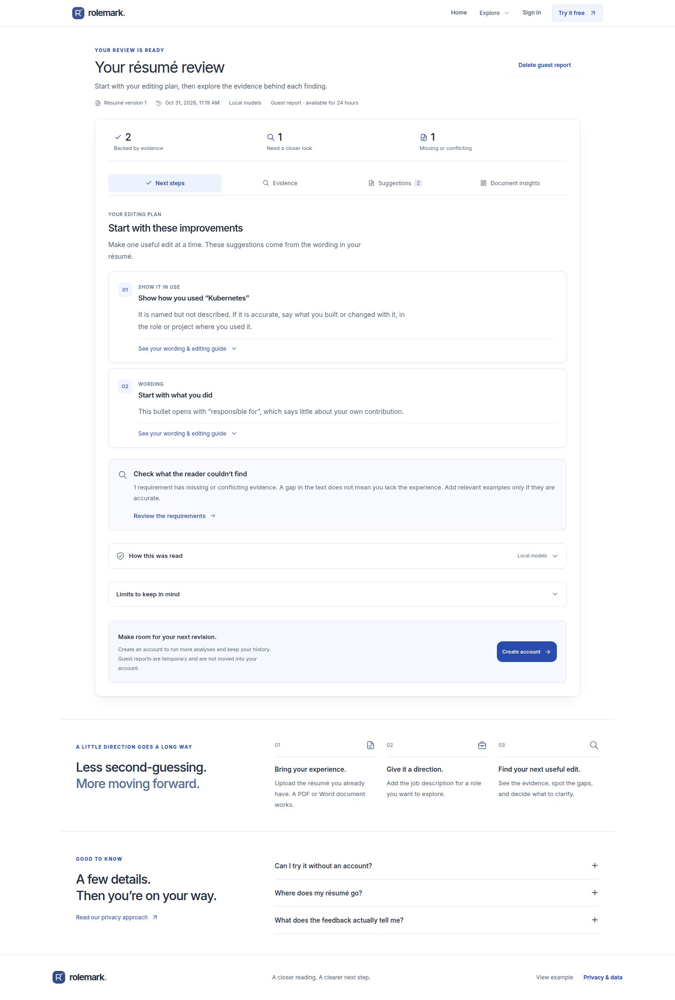

# Rolemark

Self-hosted résumé feedback with source-linked findings. Upload a résumé, add a target role, and review
what the document demonstrates, merely mentions or leaves unclear. Suggestions help you revise with
true details; the application does not generate accomplishments or predict hiring outcomes.



## Run locally

Docker with Compose is required. Preserve any existing `.env`; otherwise copy the example:

```sh
cp .env.example .env
docker compose --profile setup run --build --rm model-setup
docker compose up --build -d
```

Open [localhost:3000](http://localhost:3000). The setup command downloads about 420 MB of pinned,
checksum-verified pretrained weights once. The CPU worker then runs semantic retrieval and natural
language inference locally, with rules for entities and dates. No AI API key or hosted inference service
is used. Allow roughly 3 GB of worker memory; no GPU is required. Setup/build need internet access;
analysis runs on an internal network. See [setup](docs/quickstart.md).

For a recording, upload a synthetic PDF/DOCX on the home page or create an account, add a résumé and
role, then run a review. Open **Document insights → How this was read** to verify the report used local
semantic models. The `/demo` sample intentionally uses the rule-based reader and does not consume the
guest allowance. Existing installations must set `ML_ENABLED=true` and restart the worker after setup.

## Features

- One guest review per network every 24 hours, with temporary private report access.
- PDF/DOCX extraction with visible source text, uncertainties and manual corrections.
- Editable required/preferred job requirements tied to the original posting.
- Requirement-level evidence, source excerpts and a focused editing plan.
- Immutable versions, stale-result notices, comparisons and JSON/Markdown/CSV exports.
- Account/document deletion, durable worker jobs, bounded retries and retention maintenance.
- Keyboard-operable controls, locally bundled fonts and responsive layouts.

Guest access expires after 24 hours; failed processing restores the allowance. Deleting a report does
not reset it. An account provides additional reviews and version history. Guest reports are not moved
into a new account. The synthetic [demo](http://localhost:3000/demo) is separate from the guest quota.

## How reviews work

The baseline extracts sections and date ranges, identifies job requirements, and checks each one
against passages in the résumé. It distinguishes a listed skill from a description of using it.
Supporting and contradictory passages remain a visible conflict. Suggestions quote the original text
and provide structures you can complete with true details.

The default configured profile combines published embedding/NLI models with deterministic extraction.
It is not a model trained on your uploads, a hiring predictor or a calibrated match score. If model
loading or inference fails, a complete rule-based review remains available and the report explicitly
records that fallback. See [model provenance and limits](docs/local-models.md).

## System

| Directory | Responsibility |
| --- | --- |
| `backend/` | FastAPI, PostgreSQL, durable worker, extraction and evidence analysis |
| `frontend/` | Next.js/TypeScript interface and browser/component tests |
| `ml/` | Optional local-model training, calibration and evaluation tools |
| `models/` | Model manifests; pinned weights are provisioned separately |
| `docs/` | Setup, architecture, API, security and operational guidance |

The API accepts requests and stores immutable inputs; a separate worker performs extraction and
analysis. PostgreSQL also holds the job queue. [Architecture](docs/architecture.md) and
[decisions](docs/decisions.md) explain the transaction and isolation boundaries.

## Development checks

```sh
.venv/bin/ruff check backend/app ml
.venv/bin/mypy --config-file backend/pyproject.toml backend/app
TEST_DATABASE_URL=postgresql+psycopg://... .venv/bin/pytest backend/tests -q
cd frontend
npm run format:check
npm run typecheck
npm run lint
npm test
npm run build
```

Use a disposable test database. Browser journeys additionally need a fresh application database, API,
worker and production frontend. See [testing](docs/testing.md) and `.github/workflows/verify.yml`.

## Limits and operations

The English models compare text, not truth or qualifications. Scans need OCR, which is not
implemented. The semantic profile uses published pretrained models; résumé-domain accuracy and hiring
outcomes have not been validated. The separate custom-training lab remains experimental. The tool does not rank people, reproduce an ATS score or predict interviews.

Public operation requires HTTPS, production secrets, trusted proxy configuration, restricted database
roles, monitored backups and restoration checks. Accounts currently lack email verification and password
recovery. Resource limits reduce parser risk but are not a complete sandbox.

- [Deployment](docs/deployment.md)
- [Security, privacy and guest retention](docs/security-and-privacy.md)
- [API](docs/api.md) and [database](docs/database.md)
- [Analysis and optional local models](docs/local-models.md)

MIT. See [LICENSE](LICENSE) and [NOTICE.md](NOTICE.md). Bundled fonts retain their license notices.
