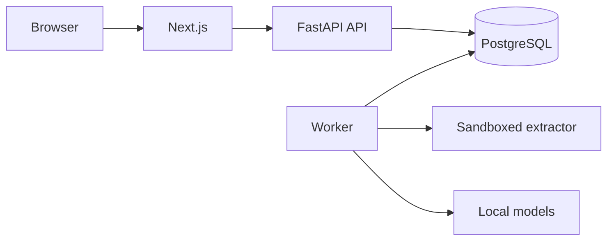

# Margin Notes

Self-hosted résumé feedback that shows its working.

Give it a résumé and a job description. For each requirement it tells you whether the résumé *supports*
it, *only mentions* it, *contradicts* it, says *too little* to count, or never touches it, and it quotes
the exact lines it relied on. There is no overall score. Everything runs on your own machines: no
third-party AI service is ever called, and your documents never leave your server.

> **Status: written, not yet run.** The code was produced and reviewed statically. No dependency was
> installed, no test, build, migration or server was run, no model was downloaded or trained, and nothing
> here claims a passing test suite, a benchmark or an accuracy figure. What has to be done before relying
> on it is listed in [Verification](#verification).

## What it does

- **Reads résumés** (PDF, DOCX) in a sandboxed child process, finds sections, dates and contact details,
  and reports where it was unsure instead of guessing. Scans fail with a clear message.
- **Reads job descriptions** into must-have and nice-to-have requirements, each tied to the sentence it
  came from, and lets you correct the list.
- **Judges evidence in context.** Models find skills, degrees and certifications and how each is claimed
  (used, listed, mentioned, negated, hedged), retrieve the passages that may relate to a requirement, and
  verify whether a passage supports, only mentions, contradicts or underspecifies it. A fixed, documented
  decision table combines the two readings; "supported" and "contradicted" together are shown as a
  conflict, never as support.
- **Explains itself.** Every result has reasons and verbatim excerpts. Probabilities appear only when
  calibrated and meeting a stated policy, and raw similarity is never shown as one.
- **Stays useful without models.** If the learned models are missing, unapproved or too slow, the
  analysis is redone with a plainly labelled rule-based reading, and says so.
- **Recommends without inventing.** Suggestions quote your résumé and leave blanks for you to fill with
  true facts; nothing is generated.
- **Keeps history.** Immutable versions, staleness detection, comparison, reports (JSON, Markdown, CSV),
  deletion of a résumé or your whole account.

## Design decisions

| Decision | Why |
| --- | --- |
| Local models only, loaded from checksum-verified, human-approved `safetensors` files; never downloaded by the app | Résumés are personal data; a supply chain you can audit |
| Three small models with separate jobs (extractor, retriever, verifier) and a rule-based baseline behind one `Engine` interface | Retrieval similarity is not evidence; a baseline keeps the app usable and gives the models something to beat |
| No overall score, no text generation | A single number invites false precision; generated text can invent claims |
| Modular monolith, PostgreSQL job queue, one worker | Simple transactions and operations; no Redis, Kafka or vector database |
| Prepare / compute / commit jobs under a per-user advisory lock | No long transactions, no deadlocks between deletion and results, no overlapping execution |
| Immutable versions with optimistic concurrency | "Which text produced this result?" is always answerable |

Reasons and rejected alternatives are in [docs/adr](docs/adr).



## Repository

```
backend/    FastAPI, SQLAlchemy, Alembic: API, documents, analysis, ML runtime, jobs, tests
frontend/   Next.js, TypeScript, Tailwind: the web app and its tests
ml/         the ML lab: datasets, synthetic data, training, calibration, evaluation, benchmarking
models/     manifest of the local models (weights are provisioned offline, never committed)
docs/       architecture, ML, data, security, API, testing, ADRs
```

## Running it

These commands are for a separate, authorised environment; none has been run. Review and lock
dependencies first.

```bash
cp .env.example .env                       # replace every CHANGE_ME; APP_ENV=development for local use

# backend, in a fresh virtualenv (add ,ml to run the learned models)
pip install -e "backend[dev]"
alembic -c backend/alembic.ini upgrade head
uvicorn app.api.main:app --app-dir backend --port 8000
(cd backend && python -m app.jobs.worker)  # second terminal

# frontend
cd frontend && npm install --ignore-scripts && npm run dev
```

Without model files the worker runs the rule-based reading, and every analysis says so. To use the learned
models you must provision, evaluate and approve them yourself: see
[docs/MODEL_SELECTION_AND_PROVENANCE.md](docs/MODEL_SELECTION_AND_PROVENANCE.md) and
[docs/TRAINING_AND_EVALUATION.md](docs/TRAINING_AND_EVALUATION.md). Create an administrator on the server
with `python -m app.cli grant-admin EMAIL`, and schedule `python -m app.cli maintenance` daily.

Production needs more than the above: TLS and trusted proxies, least-privilege database roles, and a
worker container with no network, a read-only filesystem and no secrets. See
[docs/INFERENCE_AND_DEPLOYMENT.md](docs/INFERENCE_AND_DEPLOYMENT.md).

## Verification

Written and statically checked only. Before relying on this you need to, in an authorised environment:
install from reviewed lockfiles; run the backend and frontend test suites and linters
([docs/testing.md](docs/testing.md)); run the migration and the drift test; run the ML workflow on real,
lawfully obtained, annotated data and benchmark on your hardware; test the worker container isolation with
hostile files; and confirm the model revisions. The full list is in
[docs/INFERENCE_AND_DEPLOYMENT.md](docs/INFERENCE_AND_DEPLOYMENT.md#checks-that-need-an-authorised-environment).

## Limits

It compares the wording of a résumé with the wording of a posting. It does not verify that claims are true,
predict interviews or offers, rank or screen people, or emulate applicant-tracking systems; it is
English-only; and no model has been evaluated yet, so its error rates are unknown. Read
[docs/AI_LIMITATIONS.md](docs/AI_LIMITATIONS.md) before using results to make a decision about a person.

## Documentation

| | |
| --- | --- |
| [architecture](docs/architecture.md) | system shape, jobs, locking, versioning |
| [LOCAL_ML_ARCHITECTURE](docs/LOCAL_ML_ARCHITECTURE.md) | the pipeline, models, decision table, calibration, degradation |
| [MODEL_SELECTION_AND_PROVENANCE](docs/MODEL_SELECTION_AND_PROVENANCE.md) | which models, why, licences, approval |
| [DATASET_AND_LABELING_STRATEGY](docs/DATASET_AND_LABELING_STRATEGY.md) | data, annotation guidelines, splits, leakage |
| [TRAINING_AND_EVALUATION](docs/TRAINING_AND_EVALUATION.md) | training, calibration, evaluation, promotion |
| [INFERENCE_AND_DEPLOYMENT](docs/INFERENCE_AND_DEPLOYMENT.md) | running, configuring and operating it |
| [AI_LIMITATIONS](docs/AI_LIMITATIONS.md) | what it cannot be trusted to do |
| [database](docs/database.md), [api](docs/api.md) | schema and HTTP contract |
| [security-and-privacy](docs/security-and-privacy.md), [testing](docs/testing.md) | controls, retention, test map |

## Licence

MIT, see [LICENSE](LICENSE) and [NOTICE.md](NOTICE.md).
