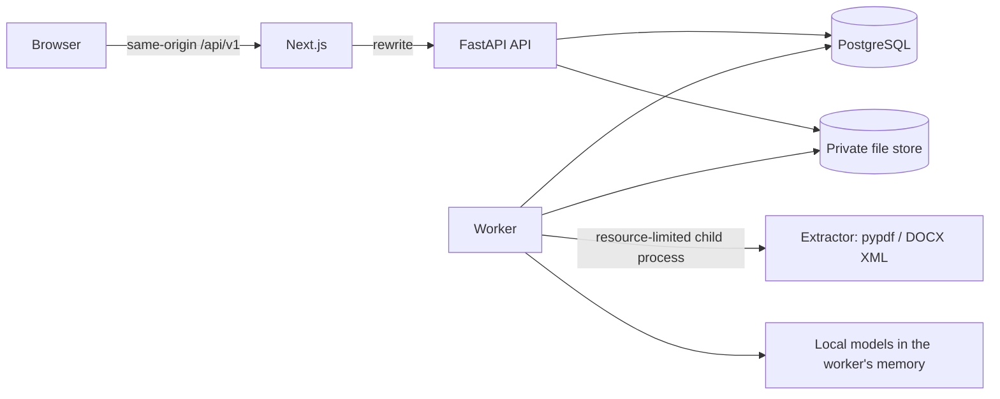

# Architecture

The shape of the system, the boundaries between its parts, and the rules that keep concurrent work
consistent. The machine-learning pipeline has its own document:
[LOCAL_ML_ARCHITECTURE.md](LOCAL_ML_ARCHITECTURE.md).

**Status.** Implemented and statically reviewed. It has not been run: no test, build, migration or server
start has been executed, so read "does" as "is written to do".

## Shape

One backend codebase, one front end, one database, one worker process. Domains are Python packages with a
one-way dependency rule, not separate services.



- The browser only talks to the Next.js origin, which proxies `/api/v1/*` to the API, so cookies are
  first-party and no cross-site cookie settings are needed.
- The API never loads models and never runs jobs. The worker owns text extraction and all inference.
- The queue is a table in PostgreSQL (`FOR UPDATE SKIP LOCKED`). No Redis, Kafka or vector database:
  nothing here needs one ([adr/0002-postgres-backed-queue.md](adr/0002-postgres-backed-queue.md)).
- There is no network call to any AI service anywhere in the system.

## Modules

```
backend/app/
  api/         routers and request/response schemas; no business rules
  auth/        passwords (Argon2id), sessions, CSRF, current user
  documents/   upload validation, sandboxed extraction, normalisation, versions, private storage
  analysis/    requirements, evidence building, summaries, recommendations, pipeline, analysis service
  ml/          contracts, decision table, calibration, manifest + artifact checks, rules and learned engines
  lang/        vocabulary (taxonomy) and small text utilities shared by rules and baselines
  jobs/        queue, worker, job-kind registry and handlers
  privacy/     deletion of résumés, job descriptions and accounts
  history/     comparison of two analyses
  reports/     JSON / Markdown / CSV export, built defensively
  admin/ demo/ db/ core/    admin counts, synthetic demo, models + locks + versioning, config + logging + security
ml/            the ML lab (training, evaluation); not imported by the application
models/        manifest and local weights
frontend/      Next.js, TypeScript, Tailwind
```

Rules:

- Routers validate input, call one service function and shape output.
- `analysis.pipeline` is pure with respect to the database: résumé, requirements and an engine in,
  results out. The worker, the public demo and the evaluation harness all call the same code.
- Ownership checks live in service `get_*` functions as a single-table predicate on `user_id`, so a router
  cannot forget one. Another user's row is reported as "not found", never "forbidden".
- `app/ml/contracts.py` and `app/ml/decision.py` import no ML library; torch and transformers are imported
  only by `app/ml/local.py` and `app/ml/models.py`, and only the worker imports those.

## Request flows

### Upload and extraction

```mermaid
sequenceDiagram
  participant U as User
  participant A as API
  participant D as PostgreSQL
  participant W as Worker
  participant X as Extractor process
  U->>A: POST /resumes (file, Idempotency-Key)
  A->>A: size, magic bytes, extension checks
  A->>D: claim idempotency key; document + version 1 + queued job (one transaction)
  A-->>U: 202 (status: processing)
  W->>D: claim job (FOR UPDATE SKIP LOCKED)
  W->>D: prepare: read the stored file reference (short transaction)
  W->>X: path + kind (CPU, memory, time limits, empty environment)
  X-->>W: lines, or a stable failure code
  W->>D: commit: version ready or failed + job settled (one transaction, user lock held)
  U->>A: poll GET /resumes/{id}
```

### Analysis

`POST /analyses` records the exact résumé version and job-description version, the pipeline version and
a queued job. The worker reads the inputs as plain data, runs the pipeline with no transaction open, and
writes matches, assessments, recommendations, the engine info and `status = succeeded` in one
transaction. A database `CHECK` makes "succeeded without results" impossible.

## Jobs

A job kind is three steps (`jobs/registry.py`), so no transaction is ever held while slow work runs:

| Step | Transaction | Does |
| --- | --- | --- |
| `prepare` | short | reads inputs as plain data; returns nothing to do if the target is gone or already settled |
| `compute` | none | extraction or inference; may renew the job's lock with a heartbeat |
| `commit` | short, under the user's lock | writes results and settles the job together |

Single ownership of outcomes: only the worker moves a job to a terminal state, and `on_failed` /
`on_cancelled` are the only code that updates the target (résumé version, analysis) for such outcomes.

- **Retries.** Transient failures (the extractor could not be started) and unexpected errors retry with
  exponential backoff up to `JOB_MAX_ATTEMPTS`. Outcomes about the input itself (a corrupt file, a
  timeout, a crash of the extractor, no extractable text) are recorded as the version's failure code at
  once: running the same file again would give the same result.
- **Cancellation.** A queued job is cancelled immediately. A running job is flagged; the worker re-reads
  the flag under the lock before writing and discards its result.
- **Stuck jobs.** A running job whose lock expired is reclaimed while attempts remain. When attempts are
  exhausted the worker settles it as failed (`worker_lost`) and fails its target. `maintenance` also
  fails any target whose job no longer exists, so nothing stays pending forever.
- **No overlap.** A job's lock lasts `JOB_LOCK_SECONDS` and is renewed while work continues; a second
  worker cannot claim a running job.

### Lock order

Every transaction that touches more than one of {user, document, version, run, job} first takes the
per-user advisory lock (`pg_advisory_xact_lock`), then row locks. The worker's commit, cancellation,
deletion, correction and account deletion all follow this order, so none of them can deadlock with
another. A lock that cannot be taken within 10 seconds fails the request with `user_busy` (503) instead of
waiting indefinitely.

## Versioning and staleness

Résumé versions and job-description versions are immutable once `ready` or `failed`. A correction creates
the next version under a row lock with an optimistic `base_version_no` check (409 `stale_base_version`
if the base is no longer the latest). Structure derived from text (entries, dates, total experience,
parseability) is recomputed from the edited blocks, never carried over.

An analysis points at exact versions and records the pipeline version and the model fingerprint. It is
**stale** when either input has a newer version, or when the pipeline or the approved models changed since
it ran. The API returns the reasons (`resume_version_superseded`, `job_description_version_superseded`,
`analysis_method_changed`).

## Idempotency

One table (`idempotency_keys`) serves uploads and analyses. Claiming a key is an
`INSERT … ON CONFLICT DO NOTHING`: the same key with the same request returns the original object; the
same key with a different request is a 409. Keys expire after 24 hours.

## Failure behaviour

| Situation | Behaviour |
| --- | --- |
| Corrupt or hostile file | Fails closed with a stable error code; no text is invented |
| Extractor timeout or crash | Process group killed; the version fails with a stable code (`extraction_timeout`, `extraction_crashed`) |
| Worker dies mid-job | Lock expires; reclaimed, or settled as failed after the last attempt |
| Learned models unavailable, too slow or out of memory | The whole analysis is redone with the rule-based reading and says so |
| User cancels | Queued: cancelled at once. Running: the worker discards its work before commit |
| Résumé or account deleted while processing | Jobs are flagged; rows cascade-deleted; the worker finds nothing to write |
| Same request repeated | The idempotency key returns the original object |
| Database unavailable | `/readyz` fails; the API returns 5xx |

## Decisions

Short records of the main decisions are in [adr/](adr/).
